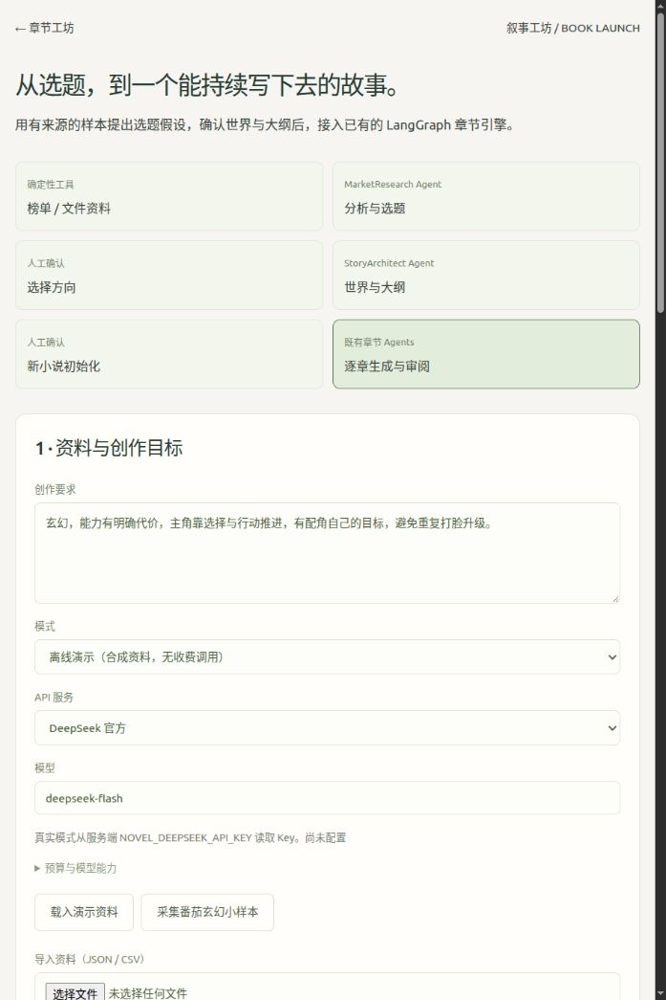
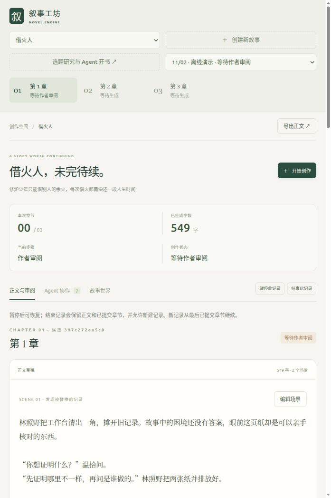

# 从选题研究到连续章节：测试与用法

更新：2026-11-02。功能在主项目内，入口 `/book-launch`，无需运行参考仓库的服务。

## 这次补足了什么

```text
公开榜单 / JSON / CSV 资料工具
    → MarketResearchAgent：有来源的观察、推断和 3–5 个候选
    → 作者选择方向（绑定 research hash）
    → StoryArchitectAgent：世界、人物、境界、全书方向、分卷、开篇十章计划
    → 作者审阅设定（绑定 blueprint hash）
    → 事务创建一本新小说
    → 现有 LangGraph 章节引擎
    → 每章 Continuity / Memory / dry-run / 文学审阅
    → 作者逐章确认提交 → 下一章
```

新增两个需要语言理解的角色；采集、引用校验、预算、存档、审批和初始化由代码完成。章节部分仍复用原来的七个角色与提交服务，没有引入第二套章节记忆系统。开书前段是持久化状态机，章节路由仍由 LangGraph 执行。

遵循仓库 `novel-engine`、`chapter-generation`、`story-memory` skills 的 Canonical/derived 边界：规划不是已发生事件；初始世界只有作者批准后才入 SQL。全书 `author_outline` 与分卷计划留在作者侧文件，公开 `public_premise` 才进入 Novel；开篇章节方向按章传给 Director。角色秘密使用带 secrecy 与 known_by 的初始 facts，不把隐藏真相塞进公开简介。

## 最快测试：隔离数据库 + 网页

建议先用独立数据库和工作目录，避免混进原有真实候选。以下命令在**同一个终端**执行；不需要 API Key：

```bash
cd /home/sty/novel_gen/novel_engine_agent_pack
conda activate novel-engine
mkdir -p .local-tests/book-launch
export NOVEL_DATABASE_URL="sqlite+aiosqlite:///$PWD/.local-tests/book-launch/test.db"
export NOVEL_STUDIO_DIRECTORY="$PWD/.local-tests/book-launch/studio"
python -m uvicorn app.main:app --host 127.0.0.1 --port 8016 --workers 1
```

打开 <http://127.0.0.1:8016/book-launch>，不要用 `file://` 打开 HTML。

1. 保持“离线演示”，默认已载入明确标记的合成资料。
2. 点击“开始市场研究”，应出现三个候选，状态为“等待选择方向”。
3. 点击一个“确认此方向”，应看到世界设定、人物、分卷和十章计划；此时尚未创建 SQL 小说。
4. 展开完整设定；如需修改，可以编辑 JSON 并点击“保存设定修订”，新候选通过结构校验后旧 hash 失效，原结果保留。确认前填写审阅人、勾选确认，点击“确认设定并开书”。这一步在测试库创建一本新小说，不创建 Chapter/Commit/Event/Snapshot。
5. 选择本次章数，例如 3，点击“按已批准计划生成”。
6. 点击“在章节工坊查看”，应直接选中该小说和该记录。第一章应显示连续性、记忆、预演通过，状态“等待作者审阅”；第 2、3 章仍在等待。
7. 核对正文与记忆，可用“让 Agent 填写”查看演示建议；选择逐条判断、五项评分、审阅人和语义确认，人工提交本章后才继续下一章。

演示模式的三个选题（《借火人》《听山契》《雨骨城》）是固定示例，不调用所选 API，即使曾经载入真实榜单也不会生成新选题。页面会提示将模式切换为真实模型，或重新载入演示资料。演示章节由已有脚本化素材生成，约数百字，不保证遵照选题的文学内容，也不是 5,000 字真实写作或市场分析质量证明。演示设定不能从本入口直接切成 live 章节；真实创作请另建 live 规划。

原服务继续用默认数据库时，直接重新启动原服务即可从工坊侧栏进入“选题研究与 Agent 开书”。上面环境变量只影响该终端及其子进程；关闭隔离服务后，在新终端运行原命令即可使用原工作区。

## 真实模型测试

在**启动服务的终端**设置对应环境变量，或在项目 `.env` 中配置，然后重启服务：

```dotenv
NOVEL_DEEPSEEK_API_KEY=你的DeepSeek官方Key
NOVEL_LLM_API_KEY=你的SCNetKey
```

网页选择“真实模型”，可选：

- DeepSeek 官方：`deepseek-flash`，以账户实际支持的名称为准。
- SCNet：默认 `DeepSeek-V4.1-Flash-1017`；`Auto` 可以手动选择，其可用性、路由、价格不作假定。
- 自定义：填 Base URL、Key 和精确模型名。Key 只在内存中保留，不写入 session、manifest、localStorage 或调用日志；服务重启后要重新输入。内置服务使用服务端环境 Key。

先点“采集番茄玄幻小样本”，或导入真实 JSON/CSV。采集限传统玄幻/玄幻脑洞两页，每页最多十条，中间间隔一秒。也可通过 CLI 选择东方仙侠等分类。只读取公开简介、书名、作者和页面指标，不读取付费章节。

采集器支持环境变量中的 HTTP(S) 和 SOCKS 代理，会将 `socks://` 规范化为 `socks5://`，并遵守 `NO_PROXY`；安装项目依赖时会安装 SOCKS 所需的 `socksio`。采集成功后页面应显示“来源资料”，真实模式不能用默认的“合成演示”。`runtime_capabilities` 的模型名称必须与当前模型名称一致。

起点目前支持手动导入，没有已验证的自动采集。遇到 202/验证码/页面结构变化时报告失败并使用导入，不伪造其他平台资料。单日二十条不代表整体热点、收入或多日增长。

首次建议只启动 **1–3 章**，每章目标 5,000 字。规划与章节预算独立：规划默认 12 次 HTTP / 200k tokens；章节默认每章 30 次 / 150k，任务 2M。预算会先保守预留输入与最大输出，所以剩余额度不足以容纳下一次请求时也会停止；usage 缺失不计零。单次最大输出可调，能力参数只对已核实模型配置，不静默切换模型。

## 命令行

CLI 是已运行服务的客户端；下面命令另开终端执行。`--server` 是全局选项，放在子命令之前。默认服务地址 8000，隔离服务示例用 8016。

```bash
cd /home/sty/novel_gen/novel_engine_agent_pack
conda activate novel-engine
python scripts/book_launch.py --server http://127.0.0.1:8016 create --mode demo
python scripts/book_launch.py --server http://127.0.0.1:8016 list
```

保存返回的 session `id`，查看任务与 hash：

```bash
launch_id='替换成返回的id'
python scripts/book_launch.py --server http://127.0.0.1:8016 show "$launch_id"
```

等状态到 `awaiting_topic`，阅读 research，选择候选并填当前 hash；等状态到 `awaiting_approval`，阅读完整 blueprint，再显式批准：

```bash
research_hash='替换成当前research_hash'
python scripts/book_launch.py --server http://127.0.0.1:8016 select "$launch_id" \
  --topic topic_1 --research-hash "$research_hash"
python scripts/book_launch.py --server http://127.0.0.1:8016 show "$launch_id"

blueprint_hash='替换成当前blueprint_hash'
python scripts/book_launch.py --server http://127.0.0.1:8016 approve "$launch_id" \
  --hash "$blueprint_hash" --reviewed-by '你的名字' --approve
python scripts/book_launch.py --server http://127.0.0.1:8016 chapters "$launch_id" \
  --count 3 --target-chars 5000 --chapter-tokens 150000 --run-tokens 2000000
```

真实市场资料采集与启动：

```bash
python scripts/book_launch.py --server http://127.0.0.1:8016 collect \
  --categories 258 257 --rank-type 2 --output .local-tests/book-launch/fanqie_sample.json

python scripts/book_launch.py --server http://127.0.0.1:8016 create --mode live \
  --provider deepseek --model deepseek-flash \
  --sample .local-tests/book-launch/fanqie_sample.json \
  --brief '玄幻，职业成长与资源代价，主角不靠预知碾压，配角有独立目标' \
  --token-budget 200000 --max-calls 12 --max-output-tokens 8192
```

再次采集时使用新文件名，工具不覆盖已有样本。SCNet 改为 `--provider scnet --model DeepSeek-V4.1-Flash-1017`。自定义增加 `--provider custom_input --base-url https://你的服务/v1 --model 模型名 --api-key-env MY_NOVEL_KEY`；把真实 Key 放在本终端 `MY_NOVEL_KEY` 环境变量中，不写在命令行参数里。自定义 `resume`、`chapters` 同样可传 `--api-key-env`。

## 暂停、恢复和预算

```bash
python scripts/book_launch.py --server http://127.0.0.1:8016 cancel "$launch_id"
python scripts/book_launch.py --server http://127.0.0.1:8016 budget "$launch_id" \
  --token-budget 300000 --max-calls 20
python scripts/book_launch.py --server http://127.0.0.1:8016 resume "$launch_id"
```

网页也可取消/恢复；暂停或失败后，在左侧填新预算，点“应用左侧新预算”，再恢复。已计入用量不会清零。研究和架构各自有绑定输入/prompt 的 checkpoint；完成阶段可复用，未完成阶段重新执行。输入、模型或 prompt 改变则拒绝直接复用，应新建规划。失败响应没有“有效输出”时，恢复会再次调用该未完成阶段。

如果已经取得市场研究结果，而架构模型超时或需要换模型，可以在页面左侧选择新服务和模型，点“复用研究并换模型”。系统创建新的规划记录，复制并校验原研究 hash，需重新选择候选，不重跑市场研究；原任务与其用量保留，新任务有独立预算，核算费用时要合计所有相关记录。命令行示例：

```bash
python scripts/book_launch.py --server http://127.0.0.1:8016 fork-research "$launch_id" \
  --provider scnet --model GLM-5.3-Flash --token-budget 200000 --max-output-tokens 8192
```

关网页不会取消后台规划；使用“取消规划”或停止服务。取消和服务关闭会 cancel 并 await 模型任务，之后不会继续开书或写库。取消规划保留资料；已创建小说的章节任务在章节工坊暂停/结束，不能用取消规划删除小说。

## 导入格式

推荐直接使用 `collect` 输出的原生 JSON；也兼容之前参考实验中的 `{categories:[{name,source_url,books:[...]}]}` 快照格式。最多 60 条观察记录，文件上限 1MB。

CSV 示例（UTF-8，简介有逗号或换行请按 CSV 规则加引号）：

```csv
id,platform,title,author,category,synopsis,source_url,observed_at,metric_name,metric_value,rank,rank_type
qidian_20261102_1,起点,你手工摘录的书名,作者,玄幻,公开简介,https://www.qidian.com/rank/xuanhuan/,2026-11-02T12:00:00+08:00,月票,123,1,玄幻月票榜
```

这是格式示例，数值不是已采集事实。ID 按“平台 + 日期 + 榜单 + 书籍”区分观察；不把同一本书不同榜单的指标混为一个值。缺失指标留空，不能补零；未核实排名留空。番茄 `readCount` 保留页面口径标记，不直接等同于付费读者或收入。

## 输出位置与接口

在 `NOVEL_STUDIO_DIRECTORY/book_launch/<session_id>/`：

- `session.json`：配置、来源、阶段、选中方向、批准 hash、新 novel ID、章节 run ID。
- `manifest.json`：输入和 prompt 签名；`checkpoint_research/`、`checkpoint_blueprint/`：带 hash 的不可覆盖结果。
- `research.json`、`blueprint.json`：可读的结构化 Agent 结果。
- `blueprint_<hash>.json`：人工或隔离测试修订后的新候选及来源 hash；原始蓝图不覆盖。
- `events.jsonl`：阶段与请求状态；live 的 `llm_calls.jsonl`：模型、request ID、耗时、token 等调用记录。
- `usage_ledger.json`：真实规划阶段的保守预算；demo 无实际 HTTP，不造用量。

章节正文、记忆、检查、审阅与提交结果在原有 `NOVEL_STUDIO_DIRECTORY/<studio_run_id>/`，网页可直接阅读并导出。规划批准不是章节批准，章节不会随开书自动提交。

主要接口见 <http://127.0.0.1:8016/docs>，前缀 `/api/v1/book-launch`：

| 方法 / 路径 | 功能 |
|---|---|
| POST `/sources/import`、`/sources/fanqie` | 导入或限量采集 |
| POST `/`（实际路径不带尾斜线）、GET `/` | 创建 / 列表 |
| GET `/{id}` | 结果、事件、预算 |
| POST `/{id}/select` | 绑定 research hash 选择方向 |
| POST `/{id}/fork-research` | 创建新规划并复用已验证的研究结果，可选择新模型 |
| POST `/{id}/approve` | 绑定 blueprint hash 创建新世界 |
| POST `/{id}/revise-blueprint` | 另存并校验修订候选，使旧批准失效 |
| POST `/{id}/chapters` | 交给现有 Studio；继承开篇计划 |
| POST `/{id}/cancel`、`/resume`、`/budget` | 中止 / 恢复 / 改预算 |

## 验证记录与下一轮测试

- **代码已实现**：两类规划 Agent、来源工具、页面、CLI、审批、事务开书、阶段恢复、取消、预算、现有章节引擎衔接；未新增依赖。
- **初始化修复**：人物先于势力创建，确保合法 `leader_name` 真正写入领袖 ID；新蓝图拒绝未知领袖引用，测试核对实际落库结果。
- **离线已验证**：新增 10 项测试通过；全量 `pytest -m 'not integration'` 为 **376 passed, 2 deselected**，包含原有十章模拟。覆盖过期选题/审批、错误引用、secret knowledge、事务中断、重试开书、取消、checkpoint 复用、实际 Agent deadline、Mock HTTP 预算/脱敏、采集受阻即停。
- **浏览器已验证**：在 `/tmp` 的隔离库中，demo 分析→选择→设定确认→章节 1 待审阅、章节 2/3 等待；服务重启恢复规划，点击链接选中正确记录。未替正式小说批准。
- **真实来源已验证**：最终 CLI 采集成功，共两类/20 条公开元数据；不代表真实市场分析质量或起点采集。
- **真实模型已验证**：本轮新增规划 Agent 尚无付费模型实测；没有读取桌面 Key 或宣称真实长篇完成。此前真实章节结果见独立报告。
- **人工已批准**：本轮没有正式真实小说批准或提交；浏览器自动操作仅是隔离合成 demo 测试。

复跑：

```bash
python -m pytest tests/test_book_launch.py -q
python -m pytest -m 'not integration' -q
```

下一轮建议用同一批真实资料分别测试 Flash 与 Auto：先看观察有没有越过来源、选题是否只是改名仿写，再看设定是否把未来写成既成事实。正式批准后先写第一章，检查计划落实、人物声音、证据与高风险记忆，再逐章推进；不能把这次离线流程验证写成真实十章验收。

浏览器测试截图：





## 开源复用说明

- [HuangLeijiana/novel-agent](https://github.com/HuangLeijiana/novel-agent)，MIT，参考 commit `d90a05e58f746da0613032605abe72756e3990e8`：借鉴 TopicScout→候选确认→世界/人物/大纲的分阶段机制。本项目使用独立 typed schema、prompt、runtime 与服务实现，没有接入其 SDK/记忆写入路径。
- [WindXRan/fanqie-radar](https://github.com/WindXRan/fanqie-radar)，MIT，参考 commit `4a6bc83ae98aaaccf9baf19ef3a36052473401bb`：借鉴公开 SSR 资料结构，实际复用小型显示字体解码表与函数到 `app/services/fanqie_text.py`，该文件保留完整版权与 MIT 许可。采集/导入是本项目独立实现；无需外部 checkout、Playwright 或额外浏览器安装。
