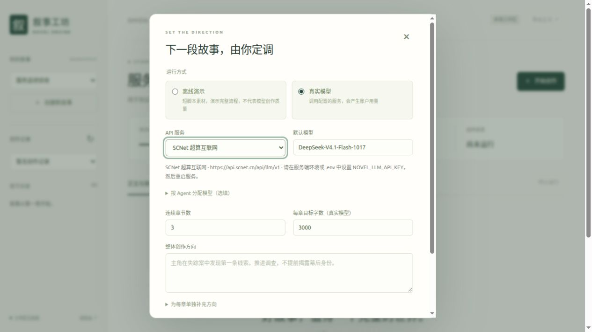
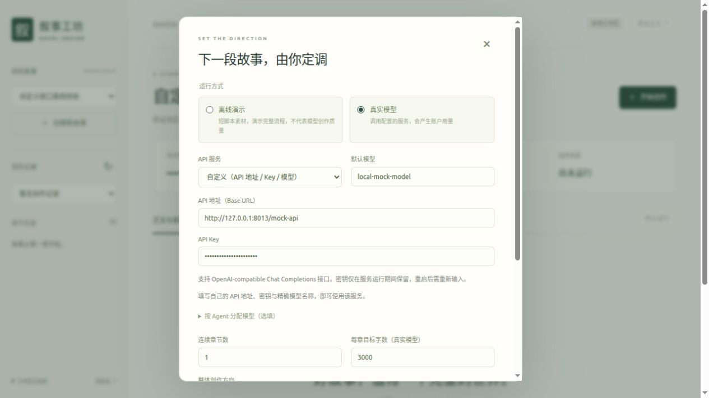
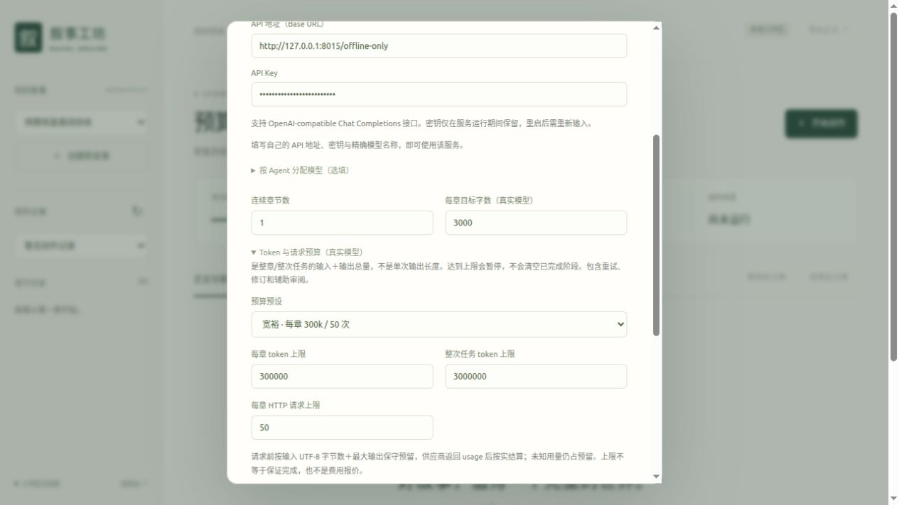
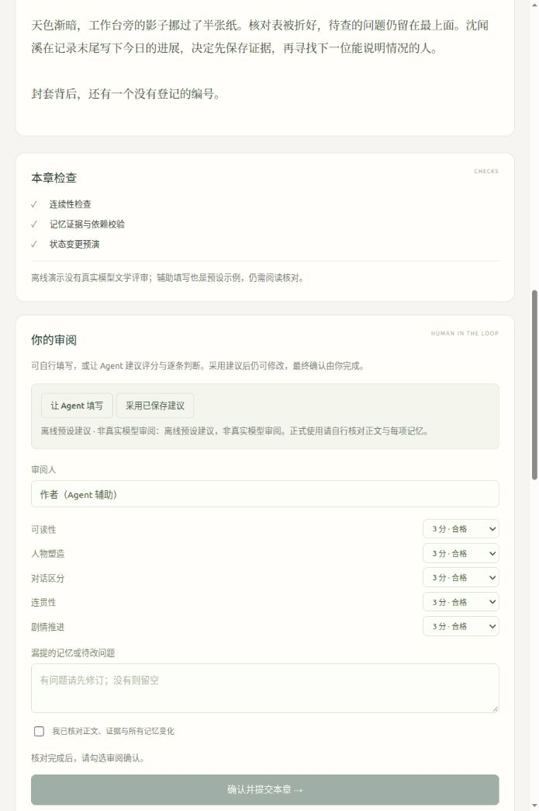

# 叙事工坊：本地连续章节创作

更新日期：2026-10-30。

工坊把现有小说引擎接入一个可操作的工作区：创建世界与角色，安排连续章节，查看各阶段输出，审阅正文和记忆，批准后继续下一章。用户本次明确要求前端与可视化，替代此前暂停 UI 的安排；真实创作验收仍独立进行。

## 启动与配置

在 `novel_engine_agent_pack` 目录、Python 3.12 环境中执行：

```bash
conda activate novel-engine
pip install -e ".[dev]"
uvicorn app.main:app --host 127.0.0.1 --port 8000 --workers 1
```

打开 [http://127.0.0.1:8000/studio](http://127.0.0.1:8000/studio)。主页 `/` 也进入工坊；`/trial` 保留旧试验台；`/docs` 是接口文档。不要直接从文件系统打开 HTML，因为页面需要同源 API 和事件连接。

工坊使用本地单 worker，目录锁会拒绝另一个进程同时拥有同一 `studio_directory`。开发时可以使用 `--reload`，但文件更新导致服务重启会中断运行，需要恢复；正式试写建议使用上面的单进程命令。运行状态和产物会保存到磁盘。

已内置以下两个真实服务，不复制 `config.yaml` 也会出现在选择框中。首次没有配置时，可将 `config.example.yaml` 复制为 `config.yaml` 调整默认值；已有配置仅修改对应字段。首次数据库可以执行 `alembic upgrade head`；工坊首次访问也会为当前数据库创建缺失表。

| 页面服务 | 默认 Base URL | 模型候选 | 密钥变量 |
| --- | --- | --- | --- |
| DeepSeek 官方 | `https://api.deepseek.com` | `deepseek-flash`（默认）、`deepseek-v4-pro` | `NOVEL_DEEPSEEK_API_KEY` |
| SCNet 超算互联网 | `https://api.scnet.cn/api/llm/v1` | `DeepSeek-V4.1-Flash-1017`（默认）、`Auto`、`DeepSeek-V4-Pro` | `NOVEL_LLM_API_KEY`（兼容已有试验） |

两家的模型 ID 各自独立。DeepSeek 官方名称及地址依据 [DeepSeek 接入文档](https://api-docs.deepseek.com/)，SCNet 地址依据 [SCNet 接口文档](https://www1.scnet.cn/ac/openapi/doc/2.0/moduleapi/api/modulequery.html)，于 2026-10-30 核对。SCNet 候选沿用项目试验配置，实际可用模型以账户为准，默认模型输入框可手动输入精确 ID。

```yaml
llm:
  default_provider: scnet
  providers:
    deepseek:
      base_url: https://api.deepseek.com
      api_key_env: NOVEL_DEEPSEEK_API_KEY
      model: deepseek-flash
      models: [deepseek-flash, deepseek-v4-pro]
    scnet:
      type: openai_compatible
      base_url: https://api.scnet.cn/api/llm/v1
      api_key_env: NOVEL_LLM_API_KEY
      model: DeepSeek-V4.1-Flash-1017
      connect_timeout_seconds: 10
      timeout_seconds: 120
      deadline_seconds: 240
      max_retries: 2
```

在服务进程环境或项目 `.env` 中填入各自的密钥，然后重启服务。进程环境优先于 `.env`；显式设置为空时禁用该密钥。只填其中一家也可以单独使用，SCNet 密钥不会用于 DeepSeek 官方。页面显示对应服务的地址、密钥变量名称与是否已配置，不回显密钥。切换服务时同步更新模型候选，并清空各 Agent 的模型覆盖，防止沿用另一家的模型 ID。

```dotenv
NOVEL_DEEPSEEK_API_KEY=你的DeepSeek官方密钥
NOVEL_LLM_API_KEY=你的SCNet密钥
```

其他兼容服务可使用不同 Provider 名称、Base URL 和 key 环境变量名。配置项可用 `NOVEL_LLM__PROVIDERS__SCNET__BASE_URL` 等双下划线环境变量覆盖；CLI 旧 runner 的单独配置变量不等同于 App 配置。已有自定义配置会覆盖相同预设字段，并保留其他服务。



### 页面直接填写自定义 API

在「开始创作 → 真实模型 → API 服务」选择「自定义（API 地址 / Key / 模型）」，填写：

- API 地址：OpenAI-compatible Base URL，例如 `https://你的服务地址/v1`。粘贴以 `/chat/completions` 结尾的完整地址时，服务器会转换为 Base URL，避免重复拼接。
- API Key：该服务的密钥，密码框显示，不需要修改 `.env` 或重启服务。
- 默认模型：服务要求的精确 ID；也可为不同 Agent 设置模型覆盖。

输入的地址和模型保存在该任务配置中；密钥仅存于当前服务进程内存，各任务独立，不写入 `run.json`、manifest、事件、日志或浏览器存储，也不在 API 响应中返回。服务重启后，继续生成、修订或重抽记忆时会弹出密钥输入框；填写后沿用已保存阶段和正文。完成最终章节的确定性提交不需要重新调用模型。

该选项使用现有 deadline、预算、证据校验与逐章审批流程。内置 DeepSeek / SCNet 选项继续支持环境变量配置。本功能的离线验证使用模拟 HTTP，未替用户发起收费模型请求。



模型名称以账户实际可用列表为准。页面在所选服务下可手动输入精确模型名称，也可按角色填写模型覆盖；留空使用本次默认模型。不会在模型失败后自动换成 Auto。只有已验证能力的参数才应加入 `model_capabilities`，不假定所有服务支持同样的 thinking、JSON 或 streaming 参数。

## 两种运行方式

| 模式 | 实际行为 | 可以证明什么 |
| --- | --- | --- |
| demo / 离线演示 | 脚本化 Provider 提供约 500–800 字/章短篇素材，使用实际 Agent 接口、LangGraph、校验、审阅和事务服务；无需网络/key | 界面、分工、状态继承与提交流程可以演示 |
| live / 真实模型 | 使用已配置的 OpenAI-compatible 服务，角色调用统一 LLM runtime；候选完成后运行文学评审 | 需结合实际结果、人类审阅和提交审计评价创作能力 |

demo 使用用户填写的角色姓名与固定十章脚本，不按目标字数扩写，也不执行用户的创作方向；脚本结束后不能继续冒充任意长篇生成。导出文本保留离线演示标记。demo 会在所选演示小说的数据库记录中产生真实的本地提交，用于演示状态继承；这些提交不算“真实模型 Canonical finalize”。建议为演示单独创建一本故事。

live 每章默认请求上限 30 次、预算 150k tokens，运行级默认 2M tokens。新建窗口可展开「Token 与请求预算」选择默认、宽裕（每章 300k / 50 次、任务 3M）、长篇（500k / 80 次、任务 5M）或自定义值；支持每章 1k–1M、任务 1k–5M、每章 1–100 次 HTTP。重试、修订、重抽记忆与辅助审阅共用台账，不因恢复清零。

「单次最大输出 tokens」是另一项设置：新记录可沿用各 Agent 配置，或统一选择 4096 / 8192 / 16384 / 32768（需模型支持）。它是发给模型的 `max_tokens`，不是整章预算；部分模型的思考 token 也计入输出。调高上限会增加预留，但不意味着供应商一定实际用满。「调整预算」不会改变该参数；完整正文已保存而检查受阻时，可通过「保留正文重新检查」修改并创建新候选。

页面会显示当前章与任务的已计入 token、已知实际用量、未知用量预留和请求次数。`Trial call/token budget exhausted; no request sent` 是本地预算保护，不是 API 余额不足，也不是卡死；即使实际用量尚未达到上限，下一次预留也可能放不下。预算耗尽后点击「调整预算」，提高对应上限、保存，再点击「恢复创作」。正在运行时须先暂停；保存预算本身不调用模型，不重跑已完成阶段、不改变正文或事实状态，原 checkpoint 签名保留生成时的额度，额度变更另有事件审计。

每次请求前按 **输入 UTF-8 字节数（保守高估）＋消息开销＋最大输出** 预留，供应商返回有效 usage 后按实结算；usage 未知时保留预留，不计为零。因此预算限制不是严格的供应商账单硬封顶，实际 usage 仍可能高于估计。停止本地请求不能保证供应商已接收请求立即停止计费。用量见 `usage_ledger.json` 和 API 事件；未核实价格时不换算费用。

节省开销：JSON/schema 仅压缩格式，保留语义描述和约束；结构化修复只携带原任务与最近一次失败，全部原始结果仍供审计；输出额度用尽且内容为空时停止相同额度重试，提示检查单次上限/思考模式。已有 Memory 输入仍保持正文与 EvidenceCatalog 不重复、FactCatalog 不重复，不删证据或降低 Validator 严格度。



## 作者操作流程

1. 创建新故事，填写标题、题材、梗概、主角、配角与不可违背的规则。这会建立初始 Canonical 世界；没有沿用旧试验故事的人物。
2. 开始创作，选择 demo/live、1–10 章、目标字数、整体方向，按需逐章补充方向。live 可为七个角色分别指定模型。
3. 在「Agent 协作」查看节点状态、角色说明与事件时间线。阶段完成后可见结构化输出和正文；API 事件显示调用状态和用量等信息，不显示模型私有思考过程。
4. 在「正文与审阅」阅读各场景，核对 Continuity、Memory Validation 与 Dry-run，以及文学报告；逐条判断 memory operation 是 correct、missing、wrong 还是 over-extracted。
5. 若需修改正文，只编辑相关场景并另存候选，重新检查整章和提取记忆；其余场景不重写。若正文正确但记忆错误，可编辑 Memory Batch 后本地校验，或重新调用 MemoryExtractor。每个候选保留独立 attempt。
6. 自行填写五项评分、审阅人和漏提项，或点击「让 Agent 填写」：Agent 建议逐条记忆判断、理由、漏提项和五项评分，填入后可以修改。确认已核对正文、证据和所有记忆变化后，手动勾选确认并提交。未通过领域校验的候选不能提交。批准绑定具体 attempt 与 preview hash；修改后旧批准失效。
7. 本章事务提交成功后，才启动下一章；下一章从已提交的状态、知识、事件与前章结尾构建上下文。到达本次章数后结束。

这是逐章人工批准的连续创作工作流，不是无人值守一次生成十章。文学评审和辅助填写都是建议，不直接代表人工批准。错误、过度抽取、漏提和低分会原样展示，不能靠辅助填写跳过校验；任何单项明显不足都应先修订，文学高分也不能覆盖事实冲突或非法记忆。

辅助填写复用 LiteraryReviewer 的角色模型与当前运行预算/超时配置；不重跑 Director、ScenePlanner 或 Writer。建议单独保存并绑定候选 hash，修改正文或记忆后旧建议失效；采用后仍需本人勾选确认。demo 只提供明确标记的离线预设建议，不冒充真实模型审阅。它目前针对章节审阅表单，不代填 API 密钥或最终批准。

真实审阅可展开「审阅模型与输出上限」为本次审阅指定同一服务中的模型及最大输出额度，不改变正文或其他 Agent 的模型。模型建议发现问题时，可点击「Agent 修订并重新审阅」生成独立记忆候选并自动复审；提示可能有误，仍需作者核对，最终确认绑定新的候选。



「故事世界」展示已提交的状态，未批准的候选不会修改人物状态、事件或知识。导出会标注候选状态，正文导出不等于批准或提交。

## 七角色与执行图

| Agent | 核心职责 | 输出与边界 |
| --- | --- | --- |
| Director | 根据当前状态与作者方向确定本章目标、因果和揭示政策 | `ChapterPlan`；不写正文、不写库 |
| ScenePlanner | 将章节计划拆成 POV、地点、人物、场景目标与字数 | `ScenePlanBatch`；读取 writer-safe 计划 |
| Writer | 逐场景写作，承接前一场景结尾 | `SceneDraft`；只见对应 POV 合理知道的信息 |
| ContinuityChecker | 检查设定、知识、时间、空间、物品与人物状态 | `ContinuityReport`；规则与语义层结合 |
| WriterRepair | 按安全修订指令定向修改问题场景 | 修订正文；至多两轮修复并复查 |
| MemoryExtractor | 从最终正文提出事件、事实、状态和知识变化 | `MemoryUpdateBatch`；EvidenceCatalog ID + FactRef，经 Validator/Dry-run |
| LiteraryReviewer | 评价可读性、人物、对话、叙事衔接与推进 | 五项 1–5 分、场景原文证据和建议；不自动改事实库 |

一个 Agent 可以调用模型多次，同一个模型也可以承担多个角色。程序编排器、ContextBuilder、KnowledgeFilter、Validator、Dry-run 和 Commit Service 不属于 LLM Agent。

`app/workflow/chapter.py` 的 LangGraph `StateGraph` 在生产 `generate_preview()` 中真实执行：

```text
Director → Draft（ScenePlanner → 逐场景 Writer）→ Continuity
                                                   ├─ 通过 → Memory → Package
                                                   └─ 阻塞 → Repair + 复查
                                                               ├─ 通过 → Memory
                                                               └─ 仍阻塞 → 停止
Package → 文学评审（live）→ 作者审阅 → 确定性事务提交 → 下一章
```

文学评审由 Studio 在候选生成后执行，demo 不调用它；图中作者审阅与提交也由 Studio 控制。LangGraph 负责章节节点路由，`TrialAttempt` 负责持久阶段与逐场景 checkpoint，没有第二套 LangGraph checkpoint 数据库。全局 Canonical 状态仍由 SQL 数据库管理，图状态不成为事实真相源。

## 暂停、结束记录、恢复与修订

点击「暂停生成 / 暂停此记录」会取消当前任务并等待它结束，之后可恢复。点击「结束此记录」则将记录归档，保留正文、候选和已提交章节，不再恢复该记录，同一本小说可以重新开始创作。也可以直接点击「开始创作」，勾选「结束旧记录并新建」：服务器先取消并等待旧任务结束，再创建新记录，不覆盖原文件。

同一本小说只运行一条未结束记录，避免同时基于同一状态提交。新记录从最后已提交章节的下一章开始；未提交草稿保留在旧记录中，但不会作为已发生事件继承。若要更换整个世界或从零写另一部小说，请选择「创建新故事」，而不是删除原故事的提交。

完成本次章节后点击「继续创作下一章」，新记录窗口会显示已提交章节以及接下来的起始章号；输入的是本次新增章节数。旧记录仍可在左侧选择。导出包含当前记录中保存的未完成草稿，并标记其状态。

最后一个正在监看运行的 SSE 连接断开，也会清理该任务；已保存阶段保留。服务关闭时取消并等待任务，重启把未完成运行标记为 interrupted；页面重新连接后可恢复。正常在审阅阶段结束事件流，不应取消随后新启动的章节。

恢复会核对本次 before-state、输入、prompt 与模型配置签名，使用已完整保存的阶段和场景，不重跑成功步骤。输入或状态发生变化时拒绝直接复用。修改正文或 Memory 会建立新的候选，避免覆盖旧稿。文学评审失败可从已保存正文继续评审，不能把恢复当作跳过报告的方式。

Canonical 提交仍是独立事务，提交失败整体回滚；重复 finalize 返回已有提交，不增加章节、事件或 snapshot。取消生成不会撤销已经批准并提交的章节。

### 已有正文的运行参数恢复

如果完整正文已保存，但后续检查因单次输出过短或 Provider 参数问题失败，可以用 `recheck` 建立新候选：继承原计划和正文及其生成元数据，重新运行 Continuity → 必要局部 Repair → Memory → 文学评审，不重跑 Director / ScenePlanner / Writer，不复用旧报告或批准。修复确有必要时正文会生成修订结果，原稿仍保留。

页面在这种情况下提供「保留正文重新检查」及输出上限选择。该操作会再次调用模型；如果只是总预算不足，请先用「调整预算」并点击「恢复创作」，以复用已完成的检查阶段。

`POST /runs/{run_id}/chapters/{number}/recheck` 接受 `max_output_tokens`、可选 `runtime_capabilities`（按模型 ID 映射）和 `role_models`。能力标记只在同一个服务/模型经过探测后使用；HTTP 接受参数并不等于语义生效，应核对实际 usage，尤其是 reasoning token。命令可用 `--review-model GLM-5.2` 明确切换检查/必要修复/记忆/评审角色，主模型和已保存的 Director/Writer 结果不变；这不是静默 fallback。

服务停止时也可使用单所有者命令（与网页服务不可同时持有同一 Studio 目录）：

```bash
python scripts/studio_continue.py --run <run_id> \
  --capabilities studio_runs/<run_id>/runtime_native_probe_20261030.json \
  --chapter-tokens 300000 --max-calls 50 --max-output-tokens 16384
```

命令需要匹配当前 SCNet 地址和模型的探测报告，沿用原任务 token 台账与总上限；停止在待人工审阅或真实错误。不会自动 approve/finalize，也不会跳过当前章去生成下一章。运行摘要写入 `recovery_<UTC时间>.json`，包含前后 state hash、用量、校验状态和错误。

若正文已有重要物品但 Draft 白名单漏声明，`POST .../memory` 可显式传 `item_declarations`：每条包含 `temporary_ref`、原文逐字名称 `name`、`source_scene_id` 和同场景 `evidence_ids`。服务器重建 Catalog 校验，不接受未知/跨场景证据或覆盖已有声明；新候选的 Draft 元数据、memory batch 与完整 preview hash 一并更新。它不是 Extractor 自动扩充白名单，原稿和旧报告仍保留，Canon 仍不变。示例：`{"temporary_ref":"new_item_1","name":"旧册","source_scene_id":"ch1_sc1","evidence_ids":["ev_0024"]}`。实际 ID 必须来自当前稿，不能照抄例子。

Memory 的 `expected_old_value` 始终比较章前 Canonical，不是同章上一条操作的中间值；完整变化过程由操作与 Event 保留，最后状态由 commit 合并。dry-run 和提交共用含心理状态的 before-state 投影，避免预演显示 `None` 或投影不一致；旧预览如提示 dry-run stale，应另存本地记忆重验，不修改历史文件。

## 数据库和产物

默认数据库为 App 配置中的 `sqlite+aiosqlite:///./novel_engine.db`；默认 Studio 目录为项目下 `studio_runs/`，可由 `NOVEL_STUDIO_DIRECTORY` 覆盖。历史 `real_trial_runs/<run>/trial.db` 各自独立，Studio 不自动导入它们，也不把历史候选当作新工坊已完成记录。

```text
studio_runs/<run_id>/
  run.json                         运行配置、章节状态、当前 attempt
  events.jsonl                     有序阶段/API 事件，可按序号重放
  llm_calls.jsonl                  live 的 HTTP 调用记录
  usage_ledger.json                live 的预算预留与实际 usage
  chapter_01/attempts/<attempt_id>/
    manifest.json                 输入/状态/配置签名
    stage_*.json                  完成的阶段和场景 checkpoint
    preview_package.json          完整候选
    chapter.txt                   正文
    memory_preview.json           候选记忆及验证
    validation_report.json
    dry_run.json
    quality.json                  live 文学评审
    review_assistance_<id>.json    绑定候选的辅助填写建议；每次调用另存
    review.json                   默认未批准的审阅模板
    approval.json                 实际批准凭据
    pending_approval.json         批准请求的恢复记录；DB 提交后断电可幂等恢复
    commit.json                   提交结果
    reading/                      可读报告、场景与记忆编辑副本
```

部分文件仅在对应步骤完成后存在。事件与审阅报告包含作者层信息，可能包含尚未向小说读者揭露的内容；发布小说时导出所需正文即可。

## 主要 API

路径前缀默认 `/api/v1/studio`，实际请求 schema 可在 `/docs` 查看。

| 方法与路径 | 功能 |
| --- | --- |
| `GET /bootstrap` | 小说、运行、Provider、七角色和工作流元信息 |
| `POST /novels` | 创建初始世界与角色 |
| `GET /novels/{novel_id}/state` | 查看已提交世界状态 |
| `POST /runs` | 创建连续章节任务；可显式传 `replace_existing=true` 结束旧记录 |
| `POST /runs/{run_id}/credentials` | 重启后补充自定义任务的内存密钥，不返回密钥 |
| `GET /runs/{run_id}/budget` | 当前章/任务用量、未知预留与上限 |
| `POST /runs/{run_id}/budget` | 暂停后修改三个总预算上限；不清零用量，不自动恢复 |
| `GET /runs/{run_id}` | 运行状态 |
| `GET /runs/{run_id}/events?after=<sequence>` | SSE 事件；支持 `Last-Event-ID` |
| `GET /runs/{run_id}/chapters/{number}` | 正文、报告、记忆、部分阶段、批准与提交结果 |
| `POST /runs/{run_id}/cancel` | 暂停并等待当前任务，可恢复 |
| `POST /runs/{run_id}/finish` | 结束并归档记录，保留产物与已提交世界 |
| `POST /runs/{run_id}/resume` | 校验签名后恢复 |
| `POST /runs/{run_id}/chapters/{number}/revise` | 指定场景另存修订 |
| `POST /runs/{run_id}/chapters/{number}/recheck` | 原计划/正文另存重检，允许明确改变输出限额与 Provider 能力设置 |
| `POST /runs/{run_id}/chapters/{number}/memory` | 本地验证修改后的记忆 |
| `POST /runs/{run_id}/chapters/{number}/memory-retry` | 同稿重新抽取记忆 |
| `POST /runs/{run_id}/chapters/{number}/assist-review` | 异步生成审阅表单建议；SSE 查看进度，章节详情读取建议 |
| `POST /runs/{run_id}/chapters/{number}/approve` | 提交明确批准的候选，成功后推进下一章 |
| `GET /runs/{run_id}/export` | 导出已生成正文，保留状态标记 |

目前没有账号、鉴权、租户隔离或公网部署管理。请绑定 `127.0.0.1`，作为本机单用户工具使用；多设备/多人远程使用需要单独实现访问控制。

## 验证状态与当前边界

- **代码已实现**：LangGraph、七角色、Studio 前后端、模型配置、审阅/修订/恢复与产物保存。
- **离线已验证**：最新全量 360 passed、2 deselected，包含预算/运行参数恢复、显式物品声明、dry-run/提交投影一致性、未知预留不清零、结束/替换记录和批准审计回归。此前浏览器验收见[记录](STUDIO_VALIDATION_20261030.md)。
- **真实模型已验证**：已实际继续 SCNet《择道者》Chapter 1，Flash 原稿与局部修订、GLM-5.2 检查/抽取/评审、本地编辑后 Memory valid 与 dry-run applicable；这不是纯 Flash 自动通过，也不是连续五章或十章验收。见[实际续跑报告](SCNET_CONTINUATION_20261030.md)。
- **人工已批准**：本轮没有新增真实小说章节批准。测试中的人工确认是自动化测试输入。

真实三章、真实十章、文学质量盲评与成本报告仍待后续运行。当前不宣称已验证数百章可靠创作。
