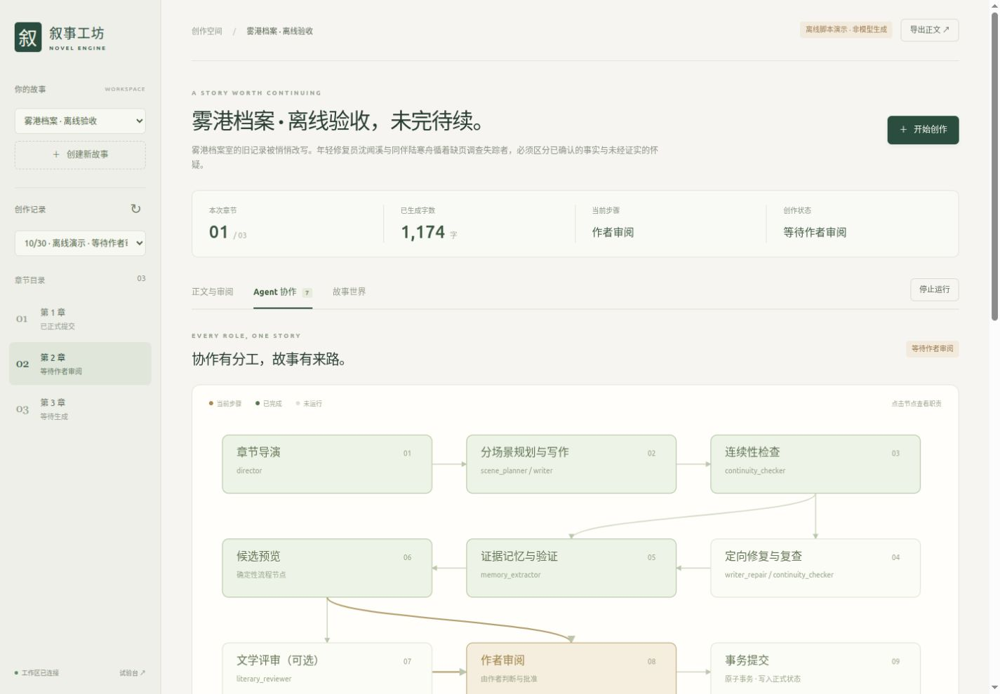

# 2026-10-30 · 本地创作工作台验收

## 实现

已有六个 Agent 保留，新增独立 LiteraryReviewer：七种 LLM 职责分别是章节导演、分场景策划、场景作家、连续性审查、定向修订、证据记忆抽取、文学评审。LangGraph 真实执行章节图，确定性服务继续负责校验与提交。

Studio 提供自定义故事初始化、1–10 章顺序任务、按角色选模型、逐章审批、局部改稿、Memory 修改/同稿重抽、停止/恢复、导出，以及 Agent 工作流和世界状态可视化。使用原有服务、Provider、知识过滤和 Canonical Commit，不建立第二个事实源。

可恢复的阶段/场景产物绑定世界状态、小说背景、输入、模型配置和 prompt；批准绑定 candidate、draft 与 memory。恢复已提交但尚未写完磁盘回执的任务时，使用 Canonical 幂等提交结果。SSE 最后观察者断开会取消并 await 对应任务，旧连接不能取消新章节。

本次顺带修复三处已观察到的问题：抽取上下文缺少 mental_condition、StoryFact 提交丢失 category、修复 checkpoint 恢复后 draft 为 dict。没有放宽领域 Validator。

## 离线证据

| 验证 | 结果 |
| --- | --- |
| 全量 `python -m pytest -m 'not integration' -q` | 329 passed、2 deselected，84.91 秒 |
| 最终 SSE 竞态修正和新增测试后：`python -m pytest tests/test_studio.py tests/test_trial_ui.py -q` | 12 passed，10.22 秒 |
| `node --check app/static/studio.js` | 通过 |
| Python 编译检查 | 通过 |

最后一轮新增了“旧连接不能取消新任务”的测试，因此不把两轮测试数量相加，也不宣称最终新增测试已在同一次全量命令中运行。

测试覆盖：真实 StateGraph 分支；修复失败不进入 Memory；永久挂起 deadline；取消无后续 Agent；checkpoint 恢复；文学证据/评分契约；自定义姓名三章和十章脚本通过 v3 校验/预演/事务提交；预览零修改；重复提交不增行；状态、事实分类及角色知识继承；审批缺失拒绝；旧审批失效；同书重复任务拒绝；失败正文可局部修订；状态变化拒绝恢复；提交后磁盘写入中断的幂等恢复；SSE 取消与旧连接竞态。

## 浏览器验收

使用隔离临时数据库，未修改原真实 trial 数据库：

1. 在页面创建《雾港档案 · 离线验收》，主角沈闻溪、配角陆寒舟。
2. 启动三章离线脚本任务，第一章在审阅阶段暂停。
3. 阅读正文、检查六项 Memory 的原文及位置；逐项选择、填写测试评分后提交。
4. 页面显示第一章已提交，第二章继续生成并继承心理状态和第一章事实。
5. 编辑第二章一个场景，重新检查并生成独立候选；原候选保留。
6. 验证 Agent 事件可展开、人物知识可选择、正式世界只显示已提交内容；浏览器控制台无错误。
7. 检查桌面和窄屏排版，修复按钮文字挤成竖排问题，无全局横向溢出。

界面测试填写的审批人为“离线界面验收（非用户批准）”，不属于真实小说人工批准。

## 尚未声称通过的部分

本轮没有调用 SCNet 或任何收费模型，没有新增真实小说 Canonical 提交。离线脚本约 500–800 字/章，不代表目标 5,000 字的模型写作质量。真实三章/十章文学质量、长篇语义连续性和成本仍需实际使用验收。API key 由服务端环境提供，能力参数仅在配置中确认后发送；Auto 不作为隐式 fallback。

本地工作台是单用户、单 worker 服务。更长篇幅的滚动剧情段规划、基于正文实际结果的场景交接、协作权限与公网部署不在这次实现内。
